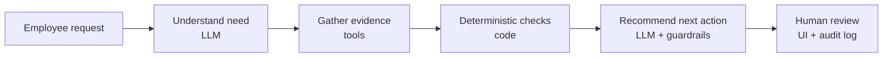

# AI Procurement Request Copilot


**Author:** Palak Agrawal &nbsp;|&nbsp; **Course:** Forward Deployed Engineering, Assessment 3

> Employees request new software. Procurement has to check existing tools, team budget, vendor status,
> security and privacy requirements, and approval rules. This copilot gathers that evidence with tools, applies
> the policy rules **in code**, and recommends the next action. **Every approval stays with a human.**

**Ship decision: Architecture A (single agent).** It is as accurate as the two-agent variant, with 43% lower
latency and a third fewer tokens. See the [decision memo](docs/decision_memo.md).

---

## Quick start

Requires Python 3.11+.

```bash
python -m venv .venv
# Windows: .\.venv\Scripts\Activate.ps1   |   macOS/Linux: source .venv/bin/activate
pip install -r requirements.txt
cp .env.example .env            # then set LLM_API_KEY (a free Gemini key works)
python verify_setup.py          # pre-flight check
python run_local.py             # one command: starts the mock vendor API and the UI
```

Open the UI at **http://127.0.0.1:8501**. The mock vendor-risk API runs on port 8001.

The LLM client is OpenAI-compatible, so any provider or gateway works by setting `LLM_BASE_URL`,
`LLM_API_KEY` and `LLM_MODEL` in `.env`. The default is Google Gemini's free tier.

## How it works



| AI (LLM) | Code (deterministic) | Human |
|---|---|---|
| Interpret the request, judge overlap with existing tools, write the recommendation from evidence | Required fields, budget, approval thresholds, Security / Privacy / Legal triggers, review expiry, vendor conflicts, tool failures, prompt-injection patterns | All approvals, exceptions and overrides |

The UI shows the **request details**, an **evidence panel** (every item linked to the tool it came from),
the **recommendation** (next action, required approvals, risk flags, missing information, next step) and
a **human review** step that records the reviewer's decision.

### Tools

| Tool | Type |
|---|---|
| `get_request_details` | Data lookup (requester text treated as untrusted) |
| `check_budget` | Deterministic |
| `search_software_catalog` | Deterministic (catalog + purchase history) |
| `get_vendor_registry` | Data lookup |
| `get_vendor_risk` | External API, with structured failures |
| `run_policy_checks` | Deterministic rules engine |

### Architectures compared

- **A: Single agent.** One Procurement Agent calls all six tools, then returns a decision. About 2 LLM calls.
- **B: Staged / two-agent.** A Procurement Analyst builds an evidence pack; a Policy/Risk Reviewer turns it into a decision. About 3 LLM calls.

Both share the same **guardrails**: approvals and rule-based flags come from code, so the model can add
reviews but never remove a required one. Evidence must cite a tool that was actually called. Human review is
always required, and if the LLM fails, a rules-only decision is returned instead of an error.

Full diagrams, the hand-off schema and assumptions: [`docs/architecture.md`](docs/architecture.md).

## Evaluation

Both architectures ran on the **same 17 cases**, twice each, using the same model (`gemini-3.1-flash-lite`).
The cases are the 6 public ones plus 11 edge cases: ambiguous requests, an existing tool that covers the need,
conflicting or expired vendor data, approval-threshold boundaries, prompt injection, and the vendor API
being unavailable. Expected outcomes were written from the policy before running.

| Metric | A: Single agent | B: Staged |
|---|---:|---:|
| Cases passing all checks | 32/34 (94%) | 32/34 (94%) |
| Policy followed (final decision) | 100% | 100% |
| Policy followed by the raw model, before guardrails | 100% | 82% |
| Evidence grounded in tool output | 100% | 100% |
| Avg / p95 latency | 11.8 s / 22.3 s | 20.8 s / 34.1 s |
| Avg LLM calls / tool calls | 2 / 6 | 3 / 6 |
| Avg tokens | 7.1k | 10.9k |

Each architecture failed one case, and both failures were over-cautious (sending a request to more human
review), never unsafe. No run approved a purchase, accepted an injected "CFO-approved" claim, or assumed a
favourable vendor status when the API was down. Per-case results:
[`evals/results/summary_combined.md`](evals/results/summary_combined.md).

**Reproduce:**

```bash
python -m pytest -q                                      # offline unit tests (no LLM needed)
python evals/run_public_evals.py --architecture single   # provided public harness
python evals/run_comparison.py --runs 1 --tag run1       # A vs B on all 17 cases
python evals/run_comparison.py --architectures rules     # deterministic-only baseline
```

## Assumptions

- Date checks use the policy's reference date, **2026-09-30**, not today's date.
- The Department Head is the Director or VP of the requester's department, or the first one up the reporting line.
- A "new vendor" is any vendor not marked Approved in the registry.
- Legal review is needed whenever a vendor's legal terms are not Approved.

## Known limitations

- Small evaluation: one free model, 17 cases, 2 runs. A larger set, labelled by Procurement, is needed before production.
- "Reuse the existing licence or buy new" is the least stable judgment, and both architectures' failures came from it.
- Prompt-injection detection is pattern-based. Guardrails limit the damage, but new phrasings rely on the model.
- Data is file-based, there is no authentication, and the review log is a local file.
- Free-tier rate limits make each request take 10–35 s.

## Project structure

```text
assignment-3/
├── app.py                Streamlit UI
├── run_local.py          one-command start (mock API + UI)
├── src/
│   ├── agents/           single.py (A), staged.py (B)
│   ├── tools.py          the six agent tools
│   ├── policy_engine.py  deterministic procurement rules
│   ├── guardrails.py     merge, grounding checks, fallback
│   ├── llm.py            OpenAI-compatible client with retries
│   └── solution.py       handle_request entry point
├── mock_api/             mock vendor-risk service
├── data/                 synthetic requests, budgets, catalog, vendors, policy
├── evals/                test cases, eval runners and saved results
├── tests/                offline unit tests
└── docs/                 architecture and decision memo
```
