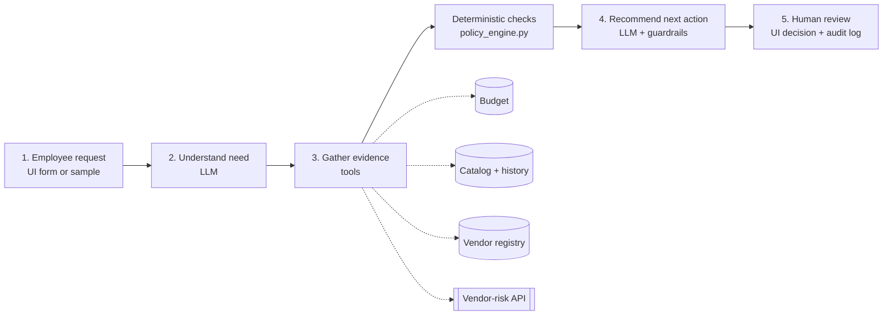
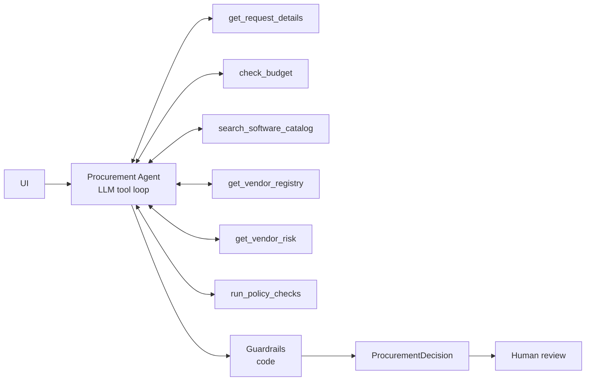
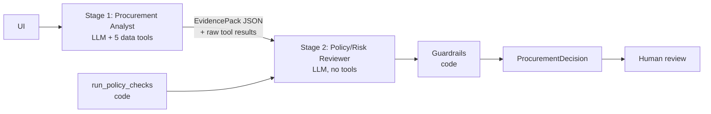

# Architecture & workflow

## Product workflow

## Who decides what

| AI (LLM) | Code (deterministic) | Human |
|---|---|---|
| Interpret the request and the need | Required-field check (policy §1) | Every approval / purchase |
| Judge whether an existing tool already covers the need (credible gap?) | Budget vs available (§2) | Exceptions & overrides |
| Judge whether the business purpose is credible | Approval thresholds incl. $1k/$10k/$25k boundaries (§4) | Resolving vendor conflicts |
| Choose the clearest next human action, write recommendation + next step | Security / Privacy / Legal triggers (§5–7), 365-day review expiry vs reference date 2026-09-30 | |
| Cite evidence from tool results | Registry-vs-API conflict, tool failure handling (§5, §10), prompt-injection patterns (§9) | |
| | Guardrail merge of the model output (below), `human_review_required = true` | |

## Tools (`src/tools.py`)

| Tool | Kind | Purpose |
|---|---|---|
| `get_request_details` | data | Request (marked untrusted), requester, department, manager, department head |
| `check_budget` | **deterministic** | Cost vs department available budget |
| `search_software_catalog` | **deterministic** lookup | Same product / vendor / category in catalog + purchase history |
| `get_vendor_registry` | data | Internal vendor registry row (procurement, security, legal terms) |
| `get_vendor_risk` | external API | Mock vendor-risk service; failures returned as structured data, never raised |
| `run_policy_checks` | **deterministic rules engine** | All policy rules; result is authoritative |

Every call is logged (name, arguments, result, latency) in a per-run `RunContext`, counted in telemetry and used to verify evidence grounding.

## Architecture A — single agent (`src/agents/single.py`)

The agent is prompted to call all tools in parallel in its first turn, so a typical run is **2 LLM calls** (tool turn + final JSON) and 6 tool calls.

## Architecture B — staged / 2-agent (`src/agents/staged.py`)

**Hand-off format (EvidencePack):** `need_summary`, `facts[{source, finding, reference}]`, `existing_tools{candidates, credible_gap}`, `vendor_status`, `data_sensitivity`, `unverified_or_missing[]`, `untrusted_content_concerns[]`. The reviewer also receives the raw tool results (so it can verify the pack) and the deterministic rules result. Typical run: **3 LLM calls**, 6 tool calls.

## Guardrails (`src/guardrails.py`) — identical for A and B

1. Business approvals (Manager / Department Head / Finance / CFO) come only from the rules engine; the model may *add* review roles (Procurement / Security / Privacy / Legal), never remove any.
2. Rule-decidable flags (`budget_insufficient`, `vendor_*`, `*_review_required`, `conflicting_vendor_evidence`) are set by code in both directions; judgment flags (e.g. `existing_tool_overlap`) may be added by the model.
3. Missing information about deterministic fields comes from code; the model may only add "business purpose" when it judges the justification not credible.
4. `next_action` can never be less conservative than the rules baseline (`request_info` / `manual_review` > `reuse_existing` / `reject` > `route_for_approval`).
5. Evidence must cite a tool that was actually called, and every number in a finding must appear in the tool outputs; otherwise it is dropped and counted (`ungrounded_evidence_dropped`).
6. Recommendations that imply autonomous approval are rewritten; `human_review_required` is always true.
7. If the LLM fails (rate limit, outage, invalid JSON after one repair), a rules-only decision is returned with the flag `llm_unavailable` and `next_action` at least `manual_review` — the product degrades, it never crashes or guesses favourably.

## Stop / escalation conditions

| Condition | Result |
|---|---|
| Material field missing (cost, users, data level, purpose, vendor) | `request_info` + `missing_information` |
| Vendor-risk service 503 / 404 / timeout | `vendor_risk_unavailable`, Security review, `manual_review` |
| Registry and risk service disagree | `conflicting_vendor_evidence`, Security, `manual_review` |
| Instruction-like text in request / vendor notes | ignored, `prompt_injection_detected`, `manual_review` |
| Budget exceeded | `budget_insufficient` + Finance |
| No budget record for the department | `budget_unverified` + Finance, `manual_review` |
| Rules engine fails on malformed data | `rules_engine_error`, Procurement, `manual_review` (never a crash) |
| Tool-loop budget (5 rounds) exhausted | model forced to answer; guardrails still apply |
| LLM unavailable | rules-only decision, `llm_unavailable` |

## Assumptions

- **Reference date** for review expiry is read from `data/procurement_policy.md` (2026-09-30), never the system clock. A review is current for ≤ 365 days.
- **Department Head** = the Director/VP in the requester's department; if none exists (Sales, Customer Success), the first Director/VP up the reporting line (Robert King, Go To Market).
- **New vendor** = not in the registry, or registry `procurement_status` ≠ Approved.
- **Legal** is required when legal terms are not `Approved` (Draft / Unknown / no record), for new vendors at ≥ $10,000, or for cross-region processing of personal data.
- **Security** is triggered by data levels `source_code`, `confidential_documents`, `employee_pii`, `customer_pii`, `credentials`, `production_*`, by production/cloud/git/secrets integrations, by a non-current or unverifiable vendor assessment, or a registry/API conflict.
- **Privacy** is triggered by employee/customer PII, or sensitive data stored outside the region.
- **Overlap** is flagged for a catalog item with the same product or category; a shared vendor alone is an existing relationship, not overlap. Overlap is never an automatic rejection.
- When annual cost is unknown, the approval tier is unknown and Procurement triages.
- `requested_integrations: []` means "none"; `null` means missing.
- The vendor client in `auto` mode falls back to the same mock app in-process if no local server is running (so evals run without `run_local.py`). HTTP error responses are never masked.

## What we intentionally did not build

- No autonomous actions (no purchase, approval, budget or contract changes).
- No more than 2 agents; no agent-to-agent negotiation loops.
- No vector store / RAG: the policy is short enough to pass in full, and rules are coded.
- No authentication or multi-user workflow; the audit log is a local JSONL file.
